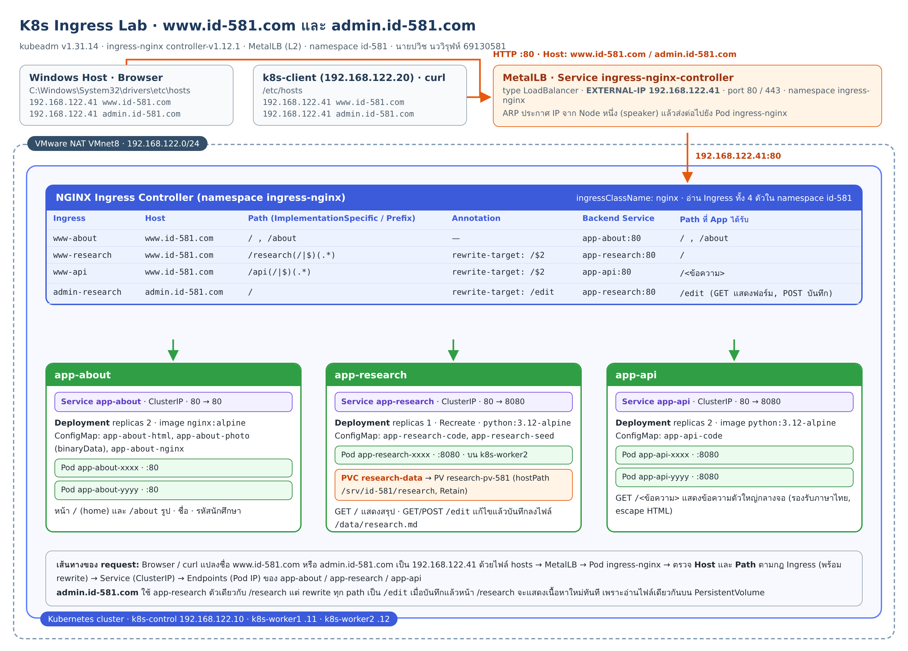

# K8s Ingress Lab — www.id-581.com

งาน **K8s Ingress** วิชา CT665 คูเบอร์เนเทสและเซิร์ฟเวอร์เลส
ผู้จัดทำ: นายปวิช นววิรุฬห์ รหัสนักศึกษา 69130581 (id-**581**)

ให้บริการเว็บ 4 ส่วนผ่าน **NGINX Ingress Controller** บน Kubernetes cluster (kubeadm, VMware)
โดยใช้ **MetalLB** แจก IP `192.168.122.41` ให้ Ingress Controller

| URL | ทำงานด้วย | สิ่งที่แสดง |
|---|---|---|
| `http://www.id-581.com/` | app-about | หน้าแรก (ลิงก์ไปทุกบริการ) |
| `http://www.id-581.com/about` | **app-about** | รูป ชื่อ และรหัสนักศึกษา |
| `http://www.id-581.com/research` | **app-research** | สรุปงานวิจัยที่นำเสนอในวิชาสัมมนา (300–500 คำ) |
| `http://www.id-581.com/api/<ข้อความ>` | **app-api** | ข้อความ `<ข้อความ>` ตัวใหญ่กลางจอ |
| `http://admin.id-581.com/` | **app-research** (path `/edit`) | หน้าแก้ไขสรุปงานวิจัยและบันทึกกลับ |



---

## โครงสร้างไฟล์

```
k8s-ingress-id-581/
├── README.md                     คำอธิบายและขั้นตอน deploy (ไฟล์นี้)
├── deploy.sh                     สคริปต์ deploy ทั้งหมดในคำสั่งเดียว
├── kustomization.yaml            รวม manifest และสร้าง ConfigMap จากไฟล์ใน apps/
├── manifests/
│   ├── 00-namespace.yaml         Namespace id-581
│   ├── 10-app-about.yaml         Deployment + Service ของ app-about (nginx:alpine)
│   ├── 20-app-research.yaml      PV + PVC + Deployment + Service ของ app-research
│   ├── 30-app-api.yaml           Deployment + Service ของ app-api
│   └── 40-ingress.yaml           Ingress 4 ตัว (www-about, www-research, www-api, admin-research)
├── apps/
│   ├── app-about/                index.html, home.html, photo.jpg, nginx.conf
│   ├── app-research/             server.py (Python), research.md (เนื้อหาเริ่มต้น)
│   └── app-api/                  server.py (Python)
├── ingress-controller/
│   ├── metallb-pool.yaml         IP pool ของ MetalLB 192.168.122.40–50
│   └── ingress-nginx-svc-patch.yaml  เปลี่ยน Service ของ controller เป็น LoadBalancer IP .41
├── hosts/
│   ├── hosts.linux               บรรทัดที่ต้องเพิ่มใน /etc/hosts
│   └── hosts.windows             บรรทัดที่ต้องเพิ่มใน C:\Windows\System32\drivers\etc\hosts
├── scripts/
│   ├── test.sh                   ทดสอบทุกเส้นทางด้วย curl
│   └── cleanup.sh                ลบทุกอย่างของ lab
└── docs/architecture.png         ไดอะแกรมสถาปัตยกรรม
```

ทุกแอปใช้ **image สำเร็จรูปจาก Docker Hub** (`nginx:alpine`, `python:3.12-alpine`) จึงไม่ต้อง build หรือ push image
โค้ดและหน้าเว็บเก็บเป็นไฟล์ปกติใน `apps/` แล้ว `kustomization.yaml` (configMapGenerator) แปลงเป็น ConfigMap ให้ตอน `kubectl apply -k .`

## สิ่งที่ต้องมีก่อน

- Kubernetes cluster: k8s-control `192.168.122.10`, k8s-worker1 `.11`, k8s-worker2 `.12` (Ready)
- MetalLB ติดตั้งแล้ว (namespace `metallb-system`)
- เครื่องทดสอบ: k8s-client `192.168.122.20` และ Windows host

## วิธี deploy (แบบสคริปต์)

```bash
git clone https://github.com/<github-user>/k8s-ingress-id-581.git
cd k8s-ingress-id-581
chmod +x deploy.sh scripts/*.sh
./deploy.sh
```

## วิธี deploy (ทีละขั้น)

```bash
# 1) ติดตั้ง NGINX Ingress Controller (baremetal)
kubectl apply -f https://raw.githubusercontent.com/kubernetes/ingress-nginx/controller-v1.12.1/deploy/static/provider/baremetal/deploy.yaml
kubectl -n ingress-nginx rollout status deploy/ingress-nginx-controller

# 2) ให้ MetalLB แจก IP 192.168.122.41 กับ Ingress Controller
kubectl apply -f ingress-controller/metallb-pool.yaml
kubectl -n ingress-nginx patch svc ingress-nginx-controller --patch-file ingress-controller/ingress-nginx-svc-patch.yaml
kubectl -n ingress-nginx get svc ingress-nginx-controller      # EXTERNAL-IP = 192.168.122.41

# 3) deploy แอปทั้งหมด + Ingress
kubectl apply -k .

# 4) ตรวจสอบ
kubectl -n id-581 get all,pvc,ingress -o wide
kubectl -n id-581 describe ingress
```

## ตั้งค่า hosts ของเครื่องที่ใช้ทดสอบ

```
192.168.122.41  www.id-581.com
192.168.122.41  admin.id-581.com
```
- Linux: `sudo nano /etc/hosts`
- Windows: เปิด Notepad แบบ Run as administrator แล้วแก้ `C:\Windows\System32\drivers\etc\hosts`

## ทดสอบ

```bash
./scripts/test.sh                              # ใช้ชื่อจาก /etc/hosts
INGRESS_IP=192.168.122.41 ./scripts/test.sh    # ไม่ต้องแก้ /etc/hosts
curl -H "Host: www.id-581.com" http://192.168.122.41/about
```

## การทำงานของ Ingress (manifests/40-ingress.yaml)

| Ingress | Host | Path | Annotation | Backend | path ที่แอปได้รับ |
|---|---|---|---|---|---|
| www-about | www.id-581.com | `/`, `/about` (Prefix) | — | app-about:80 | `/`, `/about` |
| www-research | www.id-581.com | `/research(/\|$)(.*)` | `rewrite-target: /$2` | app-research:80 | `/` |
| www-api | www.id-581.com | `/api(/\|$)(.*)` | `rewrite-target: /$2` | app-api:80 | `/<ข้อความ>` |
| admin-research | admin.id-581.com | `/` (Prefix) | `rewrite-target: /edit` | app-research:80 | `/edit` |

แยกเป็น Ingress หลายตัวเพราะ `rewrite-target` กำหนดได้ครั้งเดียวต่อ Ingress
ingress-nginx รวม Ingress ที่ใช้ host เดียวกันเป็น server block เดียวโดยอัตโนมัติ

## การเก็บข้อมูลสรุปงานวิจัย

- app-research เก็บเนื้อหาในไฟล์ `/data/research.md` บน **PersistentVolume** `research-pv-581`
  (hostPath `/srv/id-581/research` บน k8s-worker2, reclaimPolicy Retain)
- ครั้งแรกที่ Pod เริ่มทำงาน จะคัดลอกเนื้อหาเริ่มต้นจาก ConfigMap `app-research-seed`
- แก้ไขที่ `http://admin.id-581.com/` แล้วกด **บันทึก** → หน้า `/research` แสดงเนื้อหาใหม่ทันที และไม่หายเมื่อลบ Pod

## เปลี่ยนรูปในหน้า /about

แทนที่ไฟล์ `apps/app-about/photo.jpg` (ขนาดไม่เกิน ~500 KB เพราะ ConfigMap จำกัด 1 MiB) แล้วรัน `./deploy.sh` ใหม่

## ลบ lab

```bash
./scripts/cleanup.sh
```
